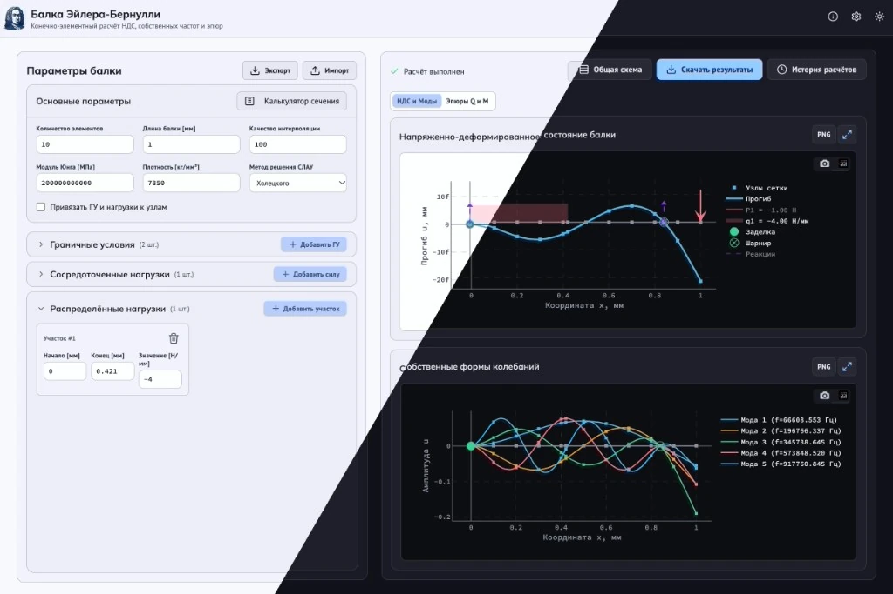
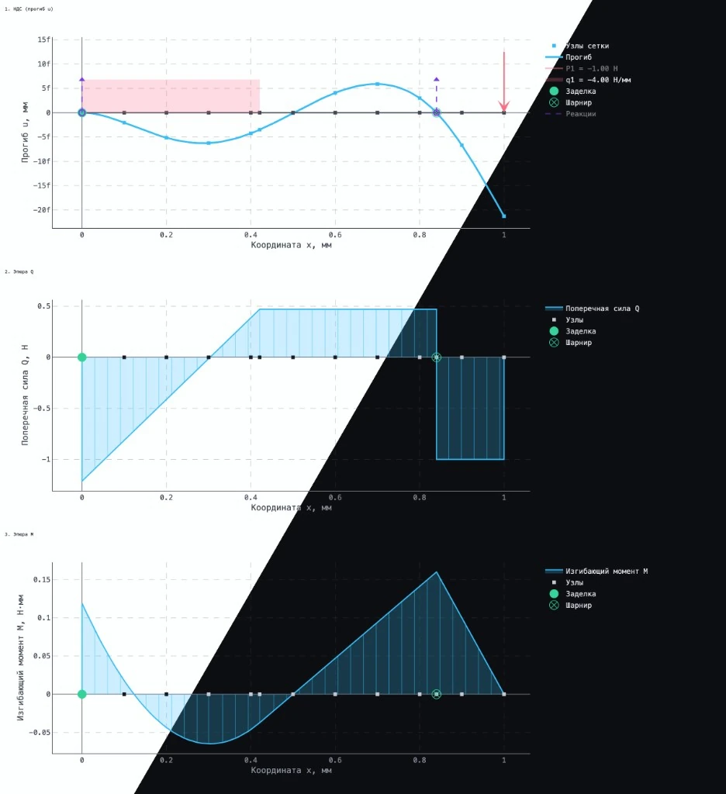

<p align="center">
  
</p>

<p align="center">
  <strong>epura</strong>
</p>

<p align="center">
  Балка Эйлера–Бернулли · МКЭ · WebAssembly
</p>

<p align="center">
  <a href="LICENSE"></a>
  
  
  
  <a href="https://beam.zipka.pro"></a>
</p>

<p align="center">
  <a href="https://beam.zipka.pro"><strong>Демо</strong></a>
  ·
  <a href="https://github.com/indraine/euler-beam"><strong>euler-beam</strong></a>
  ·
  <a href="LICENSE"><strong>License</strong></a>
</p>

---

Проект демонстрирует интеграцию математического аппарата численного анализа с веб-приложением: расчёт балки Эйлера–Бернулли методом конечных элементов выполняется средствами Rust → WebAssembly, а постановка задачи и интерпретация результатов — в браузере, без серверной части.

Расчётное ядро — библиотека [euler-beam](https://github.com/indraine/euler-beam). Клиент обеспечивает ввод параметров и нагрузок, отображение эпюр и форм колебаний, локальную историю расчётов. Производственная сборка (Vite, [vite-plugin-singlefile](https://www.npmjs.com/package/vite-plugin-singlefile)) формирует единый файл `index.html` с встроенными скриптами и модулем WASM.

<p align="center">
  
</p>

<p align="center">
  
</p>

## Быстрый старт

Требуются Node.js, npm и собранные артефакты WASM из репозитория **euler-beam**.

### 1. Модуль WebAssembly

```bash
# в клоне euler-beam
rustup target add wasm32-unknown-unknown
cargo install wasm-bindgen-cli

cargo build --lib --target wasm32-unknown-unknown --release
rm -rf pkg
wasm-bindgen \
  --target web \
  --out-dir pkg \
  --out-name euler_beam \
  target/wasm32-unknown-unknown/release/euler_beam.wasm

cp -R pkg/. /path/to/epura/src/pkg/
```

### 2. Запуск клиента

```bash
npm install
npm run dev
```

### 3. Сборка в один HTML

```bash
npm run build
```

Результат — `dist/index.html`. Просмотр: `npm run preview`.

## Лицензия

MIT — см. [LICENSE](LICENSE).
